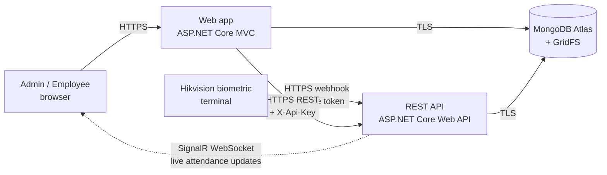
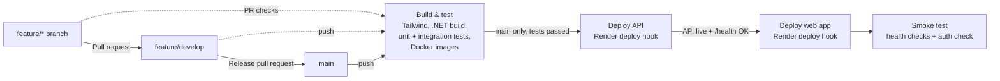

# AFCODE – Afcon Staff Attendance Register System

A digital staff attendance management system developed by **AFCODE** for **Afcon Industrial Equipment** as part of the **INSY7315 Work Integrated Learning (WIL)** project.

The system replaces Afcon's paper-based attendance register with a centralised web application that manages employee attendance, biometric device identities, attendance requests, monthly reports, employee records, departments, and employee documents.

---

## Table of Contents

- [Project Overview](#project-overview)
- [Live Deployment](#live-deployment)
- [System Demonstration Video](#system-demonstration-video)
- [Problem Statement](#problem-statement)
- [Project Objectives](#project-objectives)
- [Key Features](#key-features)
- [User Roles](#user-roles)
- [Technology Stack](#technology-stack)
- [System Architecture](#system-architecture)
- [Project Structure](#project-structure)
- [Database](#database)
- [Security](#security)
- [Getting Started](#getting-started)
- [Configuration](#configuration)
- [Running the Application](#running-the-application)
- [Testing](#testing)
- [Biometric Device Integration](#biometric-device-integration)
- [Attendance Requests](#attendance-requests)
- [Attendance Reports](#attendance-reports)
- [Employee Documents](#employee-documents)
- [Team Members](#team-members)
- [Version Control](#version-control)
- [CI/CD Pipeline](#cicd-pipeline)
- [PowerPoint Presentation](#powerpoint-presentation)
- [Future Improvements](#future-improvements)
- [AI Disclosure](#ai-disclosure)
- [References](#references)
- [License](#license)

---

## Project Overview

Afcon Industrial Equipment previously relied on a paper-based staff attendance register. This created problems such as forgotten entries, inaccurate or illegible times, proxy attendance, manual calculations, and additional administrative work when preparing attendance information.

The **Afcon Staff Attendance Register System** digitises this process. Employees can be linked to a biometric device identity and attendance records can be managed through the web application. Administrators are provided with tools for employee management, attendance monitoring, requests, reports, departments, and employee documents.

The solution is made up of two applications that share a **MongoDB Atlas** database:

- **Web app (`WIL_Afcon`)** – an ASP.NET Core MVC portal for administrators and employees.
- **REST API (`WIL_Afcon.API`)** – an ASP.NET Core Web API that receives scans from the Hikvision biometric terminal, applies the attendance rules, and pushes live updates to the web app through a SignalR hub.

Both applications use a controller, service and repository structure.

---

## Live Deployment

The system is hosted on **Render** as two Docker web services, with the database on **MongoDB Atlas**.

| Service | URL | Health check |
|---|---|---|
| Web app (admin and employee portal) | https://wil-afcon-web.onrender.com | [`/health`](https://wil-afcon-web.onrender.com/health) |
| REST API + SignalR hub | https://wil-afcon-api.onrender.com | [`/health`](https://wil-afcon-api.onrender.com/health) |

> The services run on Render's free plan, which sleeps after a period of inactivity. The first request after the service has been idle can take up to about a minute while it starts up; later requests respond normally.

**Why this hosting setup:**

- **Two separate services** keep the device-facing API apart from the user-facing portal, so each can be deployed, scaled and secured independently.
- **Docker** images are built from the same Dockerfiles in CI and on Render, so what is tested is exactly what is deployed.
- **MongoDB Atlas** is a managed database with backups and TLS, so no database server has to be maintained.
- **Render Blueprint** ([`render.yaml`](render.yaml)) keeps the whole infrastructure in source control. Secrets are entered in the Render dashboard and never committed, and the API key shared by the two services is generated by Render.
- Render's auto-deploy is off; deployments are triggered by the [CI/CD pipeline](#cicd-pipeline) only after all tests pass.

---

## System Demonstration Video

A video demonstration of the completed **AFCODE Staff Attendance Register System** is available below.

The demonstration showcases the completed system and its main functionality, including the employee and administrator interfaces, attendance management, biometric functionality, attendance requests, reporting, and document management.

**[Watch the AFCODE System Demonstration](https://www.youtube.com/watch?v=QCovuWUmQYY)**

---

## Problem Statement

The original paper attendance process presented several challenges:

- Employees could forget to record their attendance.
- Attendance could be recorded on behalf of another employee.
- Handwritten entries could be inaccurate or illegible.
- Clock-in, clock-out and break times required manual processing.
- Monthly attendance calculations were time-consuming.
- Attendance information was not centrally available to employees and administrators.
- Supporting reasons for absence, lateness or leave were difficult to connect to attendance records.

The AFCODE system was developed to provide a more accurate, secure and efficient digital alternative.

---

## Project Objectives

The project aims to:

1. Digitise Afcon's employee attendance process.
2. Improve the accuracy and reliability of attendance records.
3. Support biometric attendance identification.
4. Allow employees to view their own attendance information.
5. Allow employees to submit attendance-related requests.
6. Give administrators centralised control over employees, attendance and departments.
7. Generate monthly attendance reports for administrative use.
8. Allow employee documents such as payslips and IRP5 documents to be securely uploaded and accessed.
9. Reduce the manual administration required by the existing paper-based process.

---

## Key Features

### Employee Features

- Secure employee login.
- Personal employee dashboard.
- View personal profile information.
- View personal attendance history.
- View monthly attendance reports.
- Download personal attendance reports as CSV files.
- Submit attendance requests for matters such as lateness, absence or leave.
- Add supporting information and documentation to attendance requests.
- View the status and details of submitted requests.
- Access personal documents uploaded by an administrator.
- Biometric registration status linked through a device user ID.
- Attendance workflow supporting clock in, start break, end break and clock out.

### Administrator Features

- Secure administrator login and dashboard.
- Create, view, edit and manage employee records.
- Activate/deactivate employee records.
- Assign employees to departments.
- Link employees to biometric device user IDs.
- Manage departments.
- View attendance records across employees.
- Manually perform attendance actions as a backup when the biometric device is unavailable.
- Edit attendance information where authorised.
- View employee attendance requests.
- Accept or reject requests and add administrator comments.
- Generate employee attendance reports by month and year.
- Export attendance reports to CSV for use in applications such as Microsoft Excel.
- Upload payslips and IRP5 documents for individual employees.

---

## User Roles

The application uses role-based access control with two primary roles:

### Admin

Administrators manage the organisation's attendance information and have access to administrative functionality including employees, departments, attendance records, requests, reports and document uploads.

### Employee

Employees have access only to functionality relevant to their own account, including their attendance, requests, profile, reports and documents.

Role restrictions are enforced server-side using ASP.NET Core authorization attributes such as:

```csharp
[Authorize(Roles = "Admin")]
```

and:

```csharp
[Authorize(Roles = "Employee")]
```

---

## Technology Stack

| Area | Technology |
|---|---|
| Web app | ASP.NET Core MVC / C# |
| REST API | ASP.NET Core Web API / C# |
| Real-time updates | ASP.NET Core SignalR |
| Framework | .NET 10 |
| Database | MongoDB Atlas |
| MongoDB Driver | MongoDB.Driver |
| Authentication | ASP.NET Core Identity with AspNetCore.Identity.Mongo |
| Front End | Razor Views, HTML, CSS and JavaScript |
| Styling | Tailwind CSS and DaisyUI |
| API Documentation | Swagger / Swashbuckle |
| File Storage | MongoDB GridFS |
| Biometric device | Hikvision terminal (ISAPI event webhook) |
| Testing | xUnit, ASP.NET Core `WebApplicationFactory`, Testcontainers (MongoDB) |
| Hosting | Render (Docker web services) |
| CI/CD | GitHub Actions |
| Version Control | Git and GitHub |
| Development Environment | Visual Studio / Visual Studio Code |

### Main NuGet Packages

```text
AspNetCore.Identity.Mongo 10.1.0
MongoDB.Driver 3.11.0
Swashbuckle.AspNetCore 10.2.3
```

### Front-End Packages

```text
Tailwind CSS 4.3.3
DaisyUI 5.7.46
@tailwindcss/cli 4.3.3
```

---

## System Architecture

The solution is split into two services, each organised into controller, service and repository layers:



Inside each application:

```text
HTTP request
     |
     v
Controllers  --->  Razor Views (web app only)
     |
     v
 Services        (business rules, validation)
     |
     v
Repositories     (data access)
     |
     v
MongoDB / GridFS
```

### Web App and REST API

- The **web app** serves the admin and employee portals. Employee and attendance request operations go to the REST API through typed `HttpClient` services, which send the shared API key with every request.
- The **REST API** owns the attendance rules (clock-in window, break limits, double-scan protection), receives scan events from the Hikvision terminal, and broadcasts changes to open browser pages through the `/attendanceHub` SignalR hub.

Main API endpoints (full list in Swagger when running in Development):

| Resource | Endpoints |
|---|---|
| Employees | `GET /api/employees`, `GET /api/employees/{id}`, `POST /api/employees`, `GET /api/employees/by-device/{deviceUserId}`, `PUT /api/employees/{id}/device-binding` |
| Attendance | `GET /api/attendance`, `GET /api/attendance/employee/{employeeId}`, `POST /api/attendance/{employeeId}/clock-in`, `.../clock-out`, `.../break/start`, `.../break/end` |
| Attendance requests | `GET /api/attendance-requests`, `GET /api/attendance-requests/pending`, `POST /api/attendance-requests`, `PUT /api/attendance-requests/{id}/accept`, `PUT /api/attendance-requests/{id}/reject` |
| Departments | `GET /api/departments`, `GET /api/departments/{id}`, `POST /api/departments` |
| Documents | `POST /api/attendance-documents/upload`, `GET /api/attendance-documents/{documentId}` |
| Biometric device | `POST /api/attendance/hikvision-event`, `GET /api/attendance/device/health` |
| Health | `GET /health` |

### Controllers

Controllers handle HTTP requests, authorization and navigation between the user interface and application services.

### Services

The service layer contains the main business logic for employees, attendance, attendance requests, reporting, departments and documents.

### Repositories

Repositories provide the data-access layer between application services and MongoDB.

### Views

Razor views provide separate interfaces for administrative and employee functionality.

---

## Project Structure

```text
Development/
|
+-- README.md
+-- LICENSE
+-- render.yaml                      Render Blueprint (hosting as code)
+-- .github/
|   +-- workflows/ci.yml             CI/CD pipeline
|   +-- scripts/wait-for-render.sh   Waits for a Render deploy to go live
|
+-- WIL_Afcon/
    |
    +-- WIL_Afcon.slnx
    |
    +-- WIL_Afcon.API/               REST API + SignalR hub + device webhook
    |   +-- Configuration/           Hikvision and work-schedule options
    |   +-- Controllers/
    |   +-- Data/                    MongoDB context and index setup
    |   +-- Models/
    |   +-- RealTime/                SignalR hub
    |   +-- Repositories/
    |   +-- Security/                API key middleware, upload validation, headers
    |   +-- Services/                Attendance rules, device events, requests
    |   +-- Dockerfile
    |   +-- Program.cs
    |
    +-- WIL_Afcon.Tests/             Unit and integration tests (xUnit)
    |
    +-- WIL_Afcon/                   MVC web app (admin + employee portal)
        |
        +-- Controllers/
        |   +-- AccountController.cs
        |   +-- AdminController.cs
        |   +-- AttendanceController.cs
        |   +-- AttendanceReportController.cs
        |   +-- AttendanceRequestController.cs
        |   +-- DepartmentController.cs
        |   +-- DocumentController.cs
        |   +-- EmployeeController.cs
        |   +-- HomeController.cs
        |
        +-- Data/
        |   +-- IdentitySetup.cs
        |   +-- MongoDbContext.cs
        |   +-- MongoDbSettings.cs
        |
        +-- Models/
        |   +-- Attendance.cs
        |   +-- AttendanceRequest.cs
        |   +-- BreakRecord.cs
        |   +-- Department.cs
        |   +-- Document.cs
        |   +-- Employee.cs
        |   +-- Enums/
        |   +-- ViewModels/
        |
        +-- Repositories/
        |   +-- Interfaces/
        |   +-- AttendanceRepository.cs
        |   +-- DepartmentRepository.cs
        |   +-- DocumentRepository.cs
        |   +-- EmployeeRepository.cs
        |
        +-- Security/
        |   +-- FileUploadValidator.cs
        |   +-- SecurityHeadersExtensions.cs
        |
        +-- Services/
        |   +-- Interfaces/
        |   +-- AttendanceReportService.cs
        |   +-- AttendanceRequestService.cs
        |   +-- AttendanceService.cs
        |   +-- DepartmentService.cs
        |   +-- DocumentService.cs
        |   +-- EmployeeService.cs
        |
        +-- Views/
        |   +-- Account/
        |   +-- Admin/
        |   +-- Attendance/
        |   +-- AttendanceReport/
        |   +-- AttendanceRequest/
        |   +-- Department/
        |   +-- Document/
        |   +-- Employee/
        |   +-- Home/
        |   +-- Shared/
        |
        +-- wwwroot/
        +-- Dockerfile
        +-- Program.cs
        +-- appsettings.json
        +-- package.json
        +-- WIL_Afcon.csproj
```

---

## Database

The system uses **MongoDB** as its primary database.

Application data includes:

- Employees
- Departments
- Attendance records
- Break records
- Attendance requests
- ASP.NET Identity users
- ASP.NET Identity roles
- Employee documents

Employee documents are associated with employee records and file content is stored using **MongoDB GridFS**.

The employee model also contains a `DeviceUserId`, which links an employee in the web application to the corresponding identity used by the biometric attendance device.

### Indexes and Data Integrity

Indexes are created automatically when the applications start (existing indexes are left unchanged). Unique indexes enforce data integrity at the database level, in addition to the checks in the service layer:

| Collection | Index | Type | Purpose |
|---|---|---|---|
| Employees | `DeviceUserId` | Unique (when set) | Two employees can never share one biometric identity |
| Employees | `Email` | Unique (when set) | One employee record per email address |
| Employees | `EmployeeNumber` | Unique (when set) | No duplicate employee numbers |
| Employees | `UserId` | Unique (when set) | One employee record per login account |
| Attendance | `EmployeeId` + `AttendanceDate` (newest first) | Lookup | Today's record and attendance history |
| Attendance | `AttendanceDate` (newest first) | Lookup | Date-range lists and monthly reports |
| AttendanceRequests | `EmployeeId` + `CreatedAt` | Lookup | An employee's own requests |
| AttendanceRequests | `Status` + `CreatedAt` | Lookup | The admin queue of pending requests |
| Documents | `EmployeeId` + `UploadedAt` (newest first) | Lookup | An employee's payslips and IRP5s |

The unique indexes are *partial* (they only apply when the field has a value), so records without a device ID or employee number do not clash.

---

## Security

Security measures implemented across both applications:

### Authentication and Authorisation

- ASP.NET Core Identity authentication with unique emails and a minimum password length of 8 characters.
- Role-based access control: `[Authorize(Roles = "Admin")]` and `[Authorize(Roles = "Employee")]` are enforced server-side. All department actions are restricted to the Admin role.
- Hardened auth cookie: `HttpOnly`, `SameSite=Lax`, `Secure` outside Development, and an 8-hour expiry.
- **Account lockout** after repeated failed login attempts.
- **Rate limiting** per IP address on login and registration (10 attempts per minute by default) to slow down password guessing. Excess requests receive `429 Too Many Requests`.

### Service-to-Service and Device Security

- **API key:** every REST API request must carry the shared key in the `X-Api-Key` header. The key is compared in constant time, is held only in server configuration (generated by Render in production), and is never sent to the browser.
- **CORS** on the API only allows the web app's origin.
- **Device token:** the Hikvision webhook requires its own inbound token. Outside Development, events are rejected if no token is configured.
- The device webhook is also rate limited per IP (300 events per minute by default) to absorb burst uploads while blocking floods.

### Cross-Site Scripting (XSS) and Browser Protections

- Razor's automatic HTML encoding on all output.
- A strict **Content-Security-Policy**: scripts load only from the site itself, with no inline `<script>` blocks or `onclick` handlers, so injected markup cannot execute. `object-src 'none'` and `base-uri 'self'` are also set.
- Additional headers on every response: `X-Content-Type-Options: nosniff`, `X-Frame-Options: DENY` (clickjacking protection) and `Referrer-Policy: no-referrer`.
- HSTS and production exception handling (no stack traces shown to users).

### Input and File Validation

- Server-side validation for employees, departments, attendance requests and attendance edits, plus business-rule checks in the service layer.
- Anti-forgery tokens (`[ValidateAntiForgeryToken]`) on all state-changing form posts.
- **File uploads** are checked by extension, declared content type, size (5 MB maximum) and **file signature** (the file's first bytes must match a real PDF, PNG or JPEG), so a renamed executable is rejected.
- Unique database indexes prevent duplicate employee identities (see [Database](#database)).

### Secrets Management

- No connection strings, passwords or keys are stored in source control. Locally they are kept in .NET User Secrets; in production they are Render environment variables marked `sync: false` in [`render.yaml`](render.yaml).
- Seed admin and employee account passwords are supplied through configuration, not code.
- All connections use TLS: browser to Render over HTTPS, and both apps to MongoDB Atlas.

> **Important:** Never commit real database passwords, API keys or other secrets to source control. Use environment variables, .NET User Secrets or secure deployment configuration instead.

---

## Getting Started

### Prerequisites

Install the following before running the project:

- [.NET 10 SDK](https://dotnet.microsoft.com/)
- [Node.js and npm](https://nodejs.org/)
- Access to a MongoDB database or MongoDB Atlas cluster
- Visual Studio, Visual Studio Code, or another compatible IDE
- Git
- [Docker Desktop](https://www.docker.com/products/docker-desktop/) (only needed to run the integration tests)

### 1. Clone the Repository

```bash
git clone https://github.com/WIL-AFCON/Development.git
cd Development/WIL_Afcon
```

### 2. Restore .NET Dependencies

```bash
dotnet restore WIL_Afcon.slnx
```

### 3. Install Front-End Dependencies

```bash
cd WIL_Afcon
npm install
cd ..
```

### 4. Configure Secrets

Do **not** place credentials in source-controlled configuration files. For local development, use .NET User Secrets. Both applications need the MongoDB connection and the same shared API key:

```bash
# REST API
dotnet user-secrets --project WIL_Afcon.API set "MongoDbSettings:ConnectionString" "<your-mongodb-connection-string>"
dotnet user-secrets --project WIL_Afcon.API set "ApiSecurity:ApiKey" "<any-long-random-string>"

# Web app
dotnet user-secrets --project WIL_Afcon set "MongoDbSettings:ConnectionString" "<your-mongodb-connection-string>"
dotnet user-secrets --project WIL_Afcon set "ApiSettings:ApiKey" "<the-same-random-string>"
dotnet user-secrets --project WIL_Afcon set "SeedAccounts:AdminEmail" "<admin-email>"
dotnet user-secrets --project WIL_Afcon set "SeedAccounts:AdminPassword" "<admin-password>"
```

In production the same values are set as environment variables on Render (using `__` in place of `:`, for example `MongoDbSettings__ConnectionString`).

---

## Configuration

| Setting | Application | Purpose |
|---|---|---|
| `MongoDbSettings:ConnectionString` | Both | MongoDB Atlas connection string (secret) |
| `MongoDbSettings:DatabaseName` | Both | Database name, default `Afcon_Attendance_DB` |
| `ApiSecurity:ApiKey` | API | Key the API expects in the `X-Api-Key` header (secret) |
| `ApiSettings:ApiKey` | Web app | Key the web app sends to the API; must match the above (secret) |
| `ApiSettings:BaseUrl` | Web app | Where the web app calls the API, default `http://localhost:5199/` |
| `ApiSettings:PublicUrl` | Web app | API address the browser uses for the SignalR hub |
| `Cors:AllowedOrigins` | API | Web app origins allowed to call the API |
| `HikvisionDevice:*` | API | Terminal host, credentials and `InboundToken` for the webhook (secrets) |
| `WorkSchedule:*` | API | Attendance rules: clock-in window (06:00–12:00), late after 09:00, minimum minutes between scans, maximum breaks per day |
| `SeedAccounts:*` | Web app | Initial admin and employee login accounts (secrets) |
| `RateLimiting:LoginPermitLimitPerMinute` | Web app | Login/register attempts per IP per minute, default 10 |
| `RateLimiting:DevicePermitLimitPerMinute` | API | Device events per IP per minute, default 300 |

---

## Running the Application

Run the API and the web app in two terminals from the `WIL_Afcon` folder:

```bash
dotnet run --project WIL_Afcon.API
```

```bash
dotnet run --project WIL_Afcon
```

| Application | Development URLs |
|---|---|
| REST API | `http://localhost:5199`, `https://localhost:7285` |
| Web app | `http://localhost:5084`, `https://localhost:7073` |

Open the web app address in a browser. Swagger (`/swagger`) is enabled on both applications in the Development environment.

To rebuild the Tailwind CSS after changing styles:

```bash
cd WIL_Afcon
npx @tailwindcss/cli -i ./wwwroot/css/input.css -o ./wwwroot/css/output.css --minify
```

---

## Testing

The `WIL_Afcon.Tests` project contains **75 automated tests** (xUnit), all run by the CI pipeline on every pull request.

| Type | Files | What is tested |
|---|---|---|
| Unit | `AttendanceRulesTests`, `AttendanceRequestTests`, `AttendanceReportTests`, `DeviceUserIdTests`, `DocumentTests` | Clock-in window, break limits, double-scan rejection, request accept/reject rules, report calculations (overtime, Sunday hours, public holidays, weekly and monthly totals, CSV), unique device IDs, document ownership and download permissions |
| Integration | `ApiIntegrationTests`, `WebAppIntegrationTests` | Both apps run in memory (`WebApplicationFactory`) against a throwaway MongoDB started in Docker (Testcontainers). Covers real HTTP endpoints and status codes (200/400/401/409), the API key and device token, the unique device ID index, anonymous redirects to login, admin vs employee access, anti-forgery checks, account lockout, login rate limiting and security headers |

Run all tests from the `WIL_Afcon` folder (Docker must be running for the integration tests):

```bash
dotnet test WIL_Afcon.slnx
```

The integration tests use the `Testing` environment, so they never touch the real database.

---

## Biometric Device Integration

The system is designed to work with Afcon's biometric attendance process.

Each employee can be assigned a unique `DeviceUserId`. This creates a link between the employee stored in MongoDB and the identity registered on the biometric device/integration service.

The user interface instructs employees to use a **fingerprint or facial scan** on the biometric device to record attendance.

The attendance workflow supports:

```text
Employee identified
        |
        v
Clock In
        |
        v
Start Break
        |
        v
End Break
        |
        v
Clock Out
        |
        v
Attendance record stored and included in reporting
```

The web application also provides administrator attendance actions as a backup for situations where the biometric device is unavailable.

---

## Attendance Requests

Employees can create attendance-related requests where their normal attendance record requires additional context or approval.

The request workflow is:

```text
Employee creates request
        |
        v
Request stored as pending
        |
        v
Administrator reviews request
       / \
      /   \
 Accepted  Rejected
      |
      v
Attendance/reporting information can reflect the approved reason
```

Requests can include information such as the request type, relevant dates, a description and supporting documentation. Administrators can review the request and provide a comment when making a decision.

---

## Attendance Reports

The reporting functionality generates monthly employee attendance information using stored attendance records and relevant request information.

Reports can contain information such as:

- Employee details
- Department
- Attendance dates
- Starting and finishing times
- Break information
- Hours worked
- Attendance status
- Remarks
- Days present

Administrators can generate reports for employees, while employees can access their own reports.

Reports can also be exported as **CSV files**, allowing the information to be opened in spreadsheet software such as Microsoft Excel and used as part of Afcon's administrative process.

---

## Employee Documents

Administrators can upload employee-specific documents through the system, including:

- Payslips
- IRP5 documents

Document metadata is stored in MongoDB and the uploaded file data is stored using GridFS. Employees can access their own documents through the employee interface.

---

## Team Members

The project was developed by **AFCODE**.

| Team Member | Primary Responsibility |
|---|---|
| **Victoria (Tori) Golten** | Project Manager, Front-End Development & Documentation |
| **Kiaan Naidoo** | Lead Back-End Development |
| **Anjor (AJ) Misser** | Back-End Development |
| **Megan Jackson** | Front-End Development / UI |
| **Kiara Naidoo** | Front-End Development |
| **Diya Lakha** | All-Round Development Support |

The team collaborated across development, integration, testing, documentation and final project delivery.

---

## Version Control

Git and GitHub were used throughout the project for version control and team collaboration.

### Branching Strategy

The team follows a Gitflow-style model with three levels of branch:

| Branch | Purpose | How code gets in |
|---|---|---|
| `main` | Production. Every push deploys to Render. | Release pull request from `feature/develop` only |
| `feature/develop` | Integration branch where combined work is tested together | Pull requests from feature branches |
| `feature/*`, `fix/*` | One branch per feature or fix (for example `feature/security-hardening`, `feature/unit-tests`, `fix/identity-database-name`) | Commits by the developer working on it |

Every pull request into `feature/develop` or `main` is built and tested by GitHub Actions before it is merged, so broken code does not reach the shared branches.

Example workflow:

```bash
git checkout feature/develop
git pull
git checkout -b feature/<short-description>
# ...make changes...
git add .
git commit -m "Describe the change"
git push -u origin feature/<short-description>
# Open a pull request into feature/develop on GitHub
```

---

## CI/CD Pipeline

[](https://github.com/WIL-AFCON/Development/actions/workflows/ci.yml)

The pipeline is defined in [`.github/workflows/ci.yml`](.github/workflows/ci.yml) and runs on GitHub Actions.



| Stage | When it runs | What it does |
|---|---|---|
| Build & test | Every pull request into, and every push to, `feature/develop` or `main` | Builds the Tailwind CSS, restores and builds the solution, runs the unit tests and the integration tests (both apps run in memory against a throwaway MongoDB in Docker; results uploaded as an artifact), and builds both Docker images exactly as Render will |
| Deploy | Push to `main` only, after Build & test passes | Triggers the Render deploy hook for the API, waits until it is live and healthy, then does the same for the web app |
| Smoke test | After both deploys | Calls `/health` on both services and checks that admin pages redirect to the login page when not signed in |

Render's auto-deploy is turned off (`autoDeploy: false` in [`render.yaml`](render.yaml)), so code reaches production only after the tests pass. A failed test, a failed Render build or a failed health check stops the pipeline and marks the run red.

**Required repository secrets** (Settings → Secrets and variables → Actions):

| Secret | Where to find it |
|---|---|
| `RENDER_API_DEPLOY_HOOK` | Render → `wil-afcon-api` → Settings → Deploy Hook |
| `RENDER_WEB_DEPLOY_HOOK` | Render → `wil-afcon-web` → Settings → Deploy Hook |
| `RENDER_API_KEY` | Render → Account Settings → API Keys (lets the pipeline confirm each deploy went live) |

---

## PowerPoint Presentation

[Task 2 Final PowerPoint Presentation.pdf](https://github.com/user-attachments/files/33051345/Task.2.Final.PowerPoint.Presentation.pdf)

---

## Future Improvements

Possible future improvements include:

- Further automation between the biometric terminal and the web application.
- Expanded payroll integration.
- Additional report formats and analytics.
- Improved audit-history visualisation for administrative changes.
- End-to-end browser tests (for example Playwright) alongside the existing unit and integration tests.
- Expanded notification functionality.
- A paid hosting plan so the services never sleep, plus uptime monitoring and alerting.

---

## Academic Project

This application was developed as part of the **INSY7315 Work Integrated Learning** module and was created for the Afcon Industrial Equipment attendance-management use case.

---

## AI Disclosure

| AI Use | Description |
|---|---|
| Research | AI tools were used to research concepts, technologies and approaches relevant to the project. |
| Understanding | AI tools were used to help the team better understand the technologies and concepts used in the system. |

---

## References

daisyUI, 2026. Install daisyUI as a Tailwind plugin. daisyUI. [online] Available at: <https://daisyui.com/docs/install/> [Accessed 1 October 2026].

Fabbri, M., 2026. AspNetCore.Identity.Mongo. GitHub. [online] Available at: <https://github.com/matteofabbri/AspNetCore.Identity.Mongo> [Accessed 1 October 2026].

GitHub, 2026. Understanding GitHub Actions. GitHub Docs. [online] Available at: <https://docs.github.com/en/actions/get-started/understanding-github-actions> [Accessed 1 October 2026].

Microsoft, 2026a. ASP.NET Core middleware. Microsoft Learn. [online] Available at: <https://learn.microsoft.com/en-us/aspnet/core/fundamentals/middleware> [Accessed 1 October 2026].

Microsoft, 2026b. Dependency injection in ASP.NET Core. Microsoft Learn. [online] Available at: <https://learn.microsoft.com/en-us/aspnet/core/fundamentals/dependency-injection> [Accessed 1 October 2026].

Microsoft, 2026c. Enable Cross-Origin Requests (CORS) in ASP.NET Core. Microsoft Learn. [online] Available at: <https://learn.microsoft.com/en-us/aspnet/core/security/cors> [Accessed 1 October 2026].

Microsoft, 2026d. Enforce HTTPS in ASP.NET Core. Microsoft Learn. [online] Available at: <https://learn.microsoft.com/en-us/aspnet/core/security/enforcing-ssl> [Accessed 1 October 2026].

Microsoft, 2026e. Get started with Swashbuckle and ASP.NET Core. Microsoft Learn. [online] Available at: <https://learn.microsoft.com/en-us/aspnet/core/tutorials/getting-started-with-swashbuckle> [Accessed 1 October 2026].

Microsoft, 2026f. Health checks in ASP.NET Core. Microsoft Learn. [online] Available at: <https://learn.microsoft.com/en-us/aspnet/core/host-and-deploy/health-checks> [Accessed 1 October 2026].

Microsoft, 2026g. HTTP requests with IHttpClientFactory in ASP.NET Core. Microsoft Learn. [online] Available at: <https://learn.microsoft.com/en-us/aspnet/core/fundamentals/http-requests> [Accessed 1 October 2026].

Microsoft, 2026h. Integration tests in ASP.NET Core. Microsoft Learn. [online] Available at: <https://learn.microsoft.com/en-us/aspnet/core/test/integration-tests> [Accessed 1 October 2026].

Microsoft, 2026i. Overview of ASP.NET Core SignalR. Microsoft Learn. [online] Available at: <https://learn.microsoft.com/en-us/aspnet/core/signalr/introduction> [Accessed 2 October 2026].

Microsoft, 2026j. Prevent Cross-Site Request Forgery (XSRF/CSRF) attacks in ASP.NET Core. Microsoft Learn. [online] Available at: <https://learn.microsoft.com/en-us/aspnet/core/security/anti-request-forgery> [Accessed 1 October 2026].

Microsoft, 2026k. Rate limiting middleware in ASP.NET Core. Microsoft Learn. [online] Available at: <https://learn.microsoft.com/en-us/aspnet/core/performance/rate-limit> [Accessed 1 October 2026].

Microsoft, 2026l. Role-based authorization in ASP.NET Core MVC. Microsoft Learn. [online] Available at: <https://learn.microsoft.com/en-us/aspnet/core/mvc/security/authorization/roles> [Accessed 1 October 2026].

Microsoft, 2026m. Run an ASP.NET Core app in Docker containers. Microsoft Learn. [online] Available at: <https://learn.microsoft.com/en-us/aspnet/core/host-and-deploy/docker/building-net-docker-images> [Accessed 1 October 2026].

Microsoft, 2026n. Use hubs in ASP.NET Core SignalR. Microsoft Learn. [online] Available at: <https://learn.microsoft.com/en-us/aspnet/core/signalr/hubs> [Accessed 1 October 2026].

MongoDB, 2026a. Create and Manage Indexes – .NET/C# Driver. MongoDB Docs. [online] Available at: <https://www.mongodb.com/docs/drivers/csharp/current/indexes/> [Accessed 1 October 2026].

MongoDB, 2026b. Store Large Files – .NET/C# Driver. MongoDB Docs. [online] Available at: <https://www.mongodb.com/docs/drivers/csharp/current/crud/gridfs/> [Accessed 1 October 2026].

Render, 2026a. Blueprint YAML Reference. Render Docs. [online] Available at: <https://render.com/docs/blueprint-spec> [Accessed 1 October 2026].

Render, 2026b. Deploy Hooks. Render Docs. [online] Available at: <https://render.com/docs/deploy-hooks> [Accessed 1 October 2026].

Tailwind Labs, 2026. Tailwind CLI. Tailwind CSS. [online] Available at: <https://tailwindcss.com/docs/installation/tailwind-cli> [Accessed 1 October 2026].

Testcontainers, 2026. MongoDB. Testcontainers for .NET. [online] Available at: <https://dotnet.testcontainers.org/modules/mongodb/> [Accessed 1 October 2026].

xUnit.net, 2026. Getting started with xUnit.net v2. xUnit.net. [online] Available at: <https://xunit.net/docs/getting-started/v2/getting-started> [Accessed 1 October 2026].

---

## License

This repository contains a `LICENSE` file. Refer to that file for the licensing terms applicable to the project.

---

**AFCODE – Afcon Staff Attendance Register System**  
*Developed for Afcon Industrial Equipment as part of INSY7315.*
